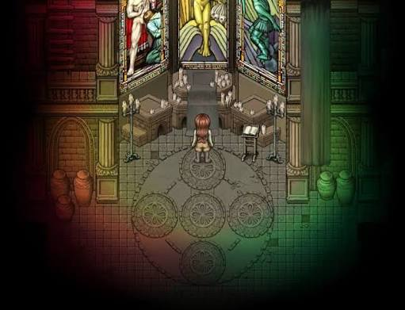
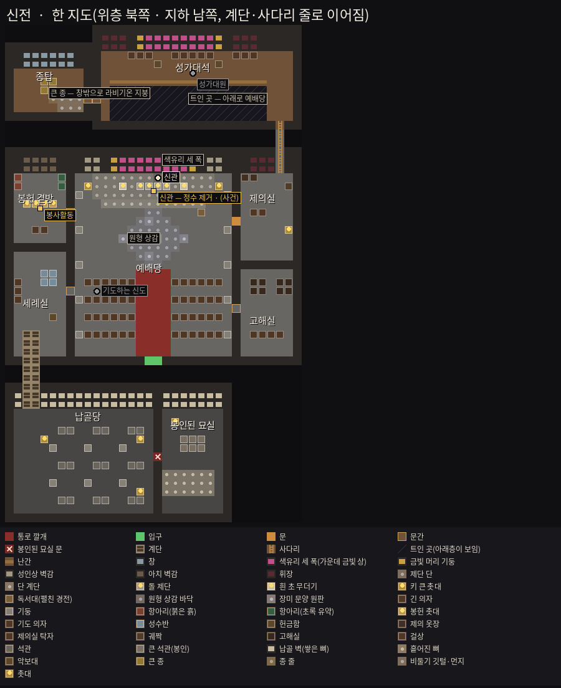
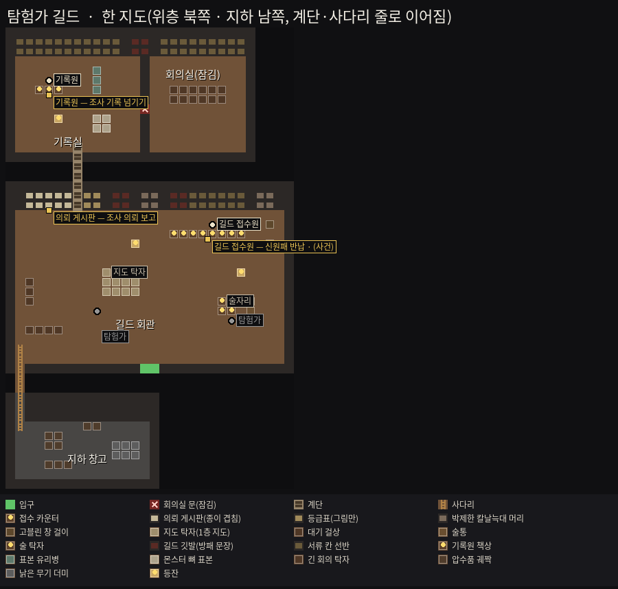
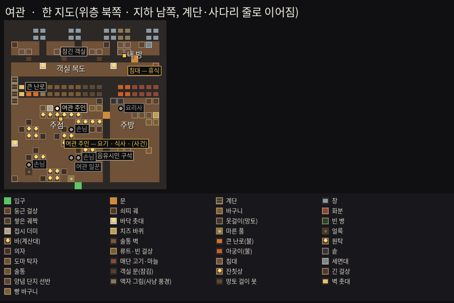
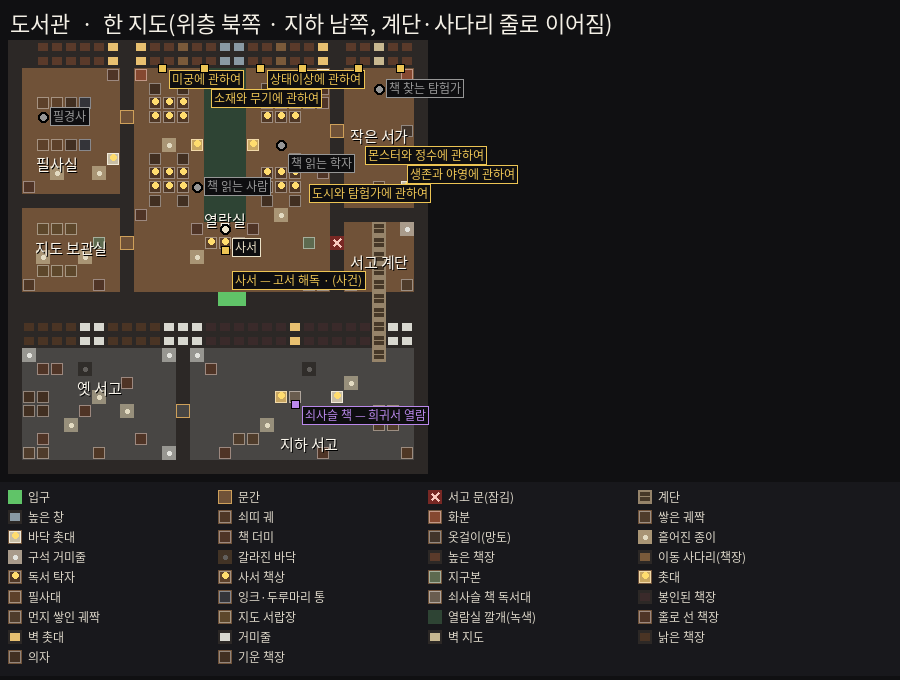
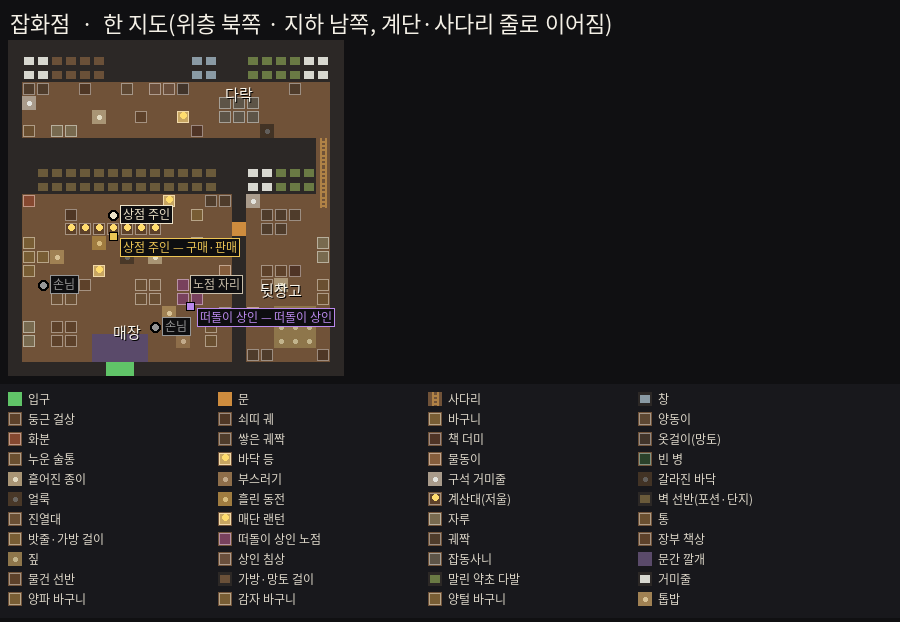
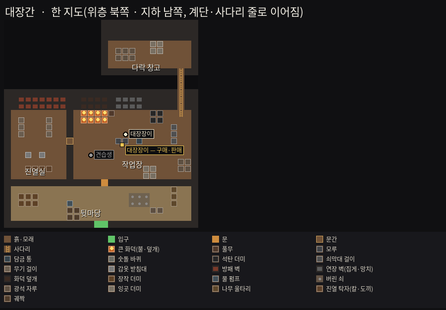
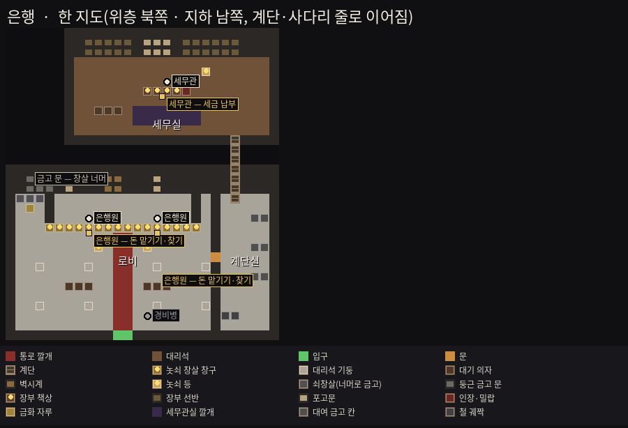
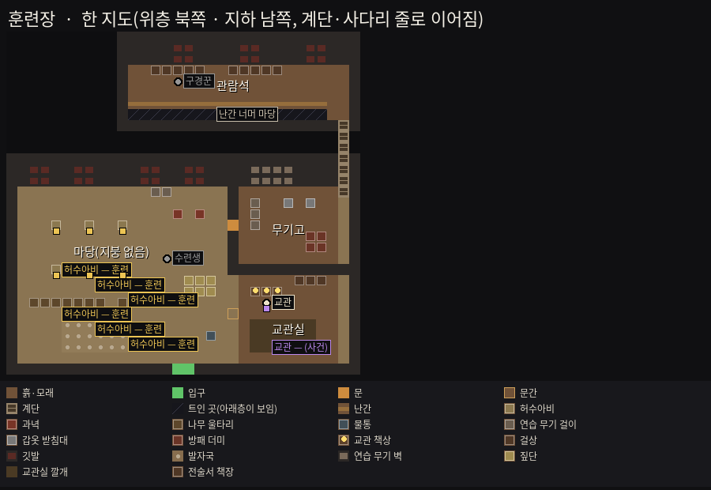

# 도시 실내 — 복층·여러 방 구상 (2026-10-31 구현됨 — CT66)

> 2026-10-31 사용자: "지금 방 구조가 컨테이너 박스야. 도시 구역이 하나이다 보니 복층+많은 방 구조일 필요가 있을 듯. 복층 오가는 경우는 계단과 사다리로 표현
> (피어 앤 헝거 1처럼 위아래로 걷는 애니메이션으로 오르내리기, 사다리 타일 위일 때는 좌우 못 하게). 진짜 만들어 넣지는 말고 기획 구상만. 교회는 첨부 그림 참고.
> 그 건물의 분위기를 드러내는 가구랑 장식 타일이 많으면 좋겠다."
>
> **상태: 구현됨(2026-10-31, CT66 — 복층은 한 지도에서 계단·사다리 줄로 이어진다, 아래 §3·§4·§7과 다른 점은 ASSUMPTIONS CT66). 지도 정본 = `data/rooms/<id>.json`.** 아래는 기획 때 글이다. 지금 실내 방(CT62·CT64)은 방 하나짜리 그림 한 장 + 소품 몇 개다.
> **결정은 §9**(2026-10-31 — 추천대로, 정수 제거 방만 빼고). **배치도**(균열 배치도처럼 그림으로): `docs/plans/city_boards/<건물>.png` ← 설계도 `<건물>.json` ← `python3 tools/city_boards.py`. 만들 때는 §8 순서로.

---

## 1. 지금 무엇이 모자란가

| 지금(CT64) | 문제 |
|---|---|
| 시설마다 방 하나(16×11칸), 사방이 벽 | 건물 안이 "상자 하나" — 둘러볼 곳이 없다 |
| 방 그림 = 통짜 한 장(`RoomArt`) + 소품 4~7개 | 칸 하나하나를 고칠 수 없다. 방을 늘리면 그림을 처음부터 다시 그린다 |
| 벽 장식은 뒷벽 한 면뿐 | 옆벽·방 사이 벽·바닥 장식이 없다 — 그 건물다운 물건이 적다 |
| 층 개념 없음 | 위층 객실·지하 납골당·다락 같은 "다른 곳"이 없다 |

도시가 한 구역(라비기온 7구역)뿐이라 **도시의 깊이는 건물 안에서 나와야 한다.** 거리는 짧게, 건물은 깊게.

---

## 2. 구조 원칙

- **건물 = 층 여러 개, 층 = 방 여러 개 + 복도/문간.** 층마다 지도 하나(지금 방 JSON과 같은 칸 글자 지도). 같은 층의 방은 문간(열린 칸)이나 문(다가가면 열림)으로 잇는다.
- **층 사이 = 계단 또는 사다리**(§3). 같은 건물 안을 오가는 것은 행동력을 쓰지 않는다 — 행동력은 지금처럼 **건물 한 번 다녀오기에 1, 나올 때**(CT62).
- **크기 기준**: 층 하나 최대 약 40×28칸, 방 3~6개. 건물 전체 2~3층.
- **걷는 시간 기준**: 입구에서 **그 시설의 주 활동까지 5초 안**(1층 입구 가까이). 위층·지하는 부 활동 + 분위기 + 사건 때만 열리는 곳. 매달 아홉 번 들어가는 곳이라 주 활동이 멀면 귀찮아진다.
- **활동 규칙은 그대로**: 한 방문에 창구가 아닌 활동 하나(`city.json room.activities_per_visit`), 창구는 세지 않는다(CT64). 이름판·선택 창·창구 카드도 그대로.
- **부연설명 금지는 그대로**: 안내판·설명문 타일 없음. 문패 대신 그 방의 물건으로 무슨 방인지 알게 한다(간접 체험, UI19).

---

## 3. 층 오가기 — 계단 · 사다리

### 3-1. 계단

- **올라가는 계단**: 북쪽 벽에 붙어 위로 오르는 계단 2~3칸(3/4 시점에서 디딤판이 위로 좁아진다). **내려가는 계단**: 바닥에 뚫린 입구, 디딤판이 남쪽으로 어둠 속에 잠긴다.
- **계단 칸 위**: 위·아래 입력만 받고 좌우는 막는다(사다리와 같은 규칙 — 계단 옆으로 떨어지는 그림이 어색하다). 걷는 빠르기 ×0.7.
- **애니메이션**: 올라갈 때 = 뒷모습 걷기 줄, 내려갈 때 = 앞모습 걷기 줄(지금 몸 그림 시트의 아래·위 줄 그대로). 디딤판 한 칸마다 몸이 3~4px 오르내린다(피어 앤 헝거 1처럼 계단을 밟는 느낌).
- **끝 칸 = 층 연결**: 계단 맨 위(아래) 칸에 들어서면 화면이 0.35초 어두워졌다가(지금 `rift_passage.fade_sec`와 같은 값) 다른 층의 도착 칸에서, 같은 방향을 보고 선다.

### 3-2. 사다리

- **벽 사다리**(올라감 — 다락·종탑·관람석) · **바닥 구멍 사다리**(내려감 — 술 창고·지하 창고).
- **사다리 칸 위에서는 좌우 입력을 무시**하고 보는 방향은 위로 고정(뒷모습). 빠르기 ×0.5.
- **애니메이션**: 1단계 = 뒷모습 걷기 줄을 느리게 돌리며 몸을 위아래로 흔든다(피어 앤 헝거 1 방식). 2단계(선택) = 몸 그림 시트에 **"오르기" 줄을 하나 더**(팔·다리를 번갈아 뻗는 뒷모습 4칸 — `tools/paint_actors.gd`에 자세 하나, `ActorSheet` 줄 4 → 5). 다섯 종족 다시 그리기 약 2분.
- 사다리 아래 칸에서 위를 보고 이동 = 오르기 시작, 맨 위 칸 = 층 연결(계단과 같은 연출).
- **내려갈 때**: 구멍 가장자리에서 아래로 = 몸을 돌려(뒷모습 그대로) 내려간다.

### 3-3. 문

- **문간**: 그냥 열린 칸(아치 그림). **문**: 닫힌 그림 → 플레이어가 한 칸 앞에 오면 열린 그림(+ 소리 키 `door_open` — 글로 쓰지 않는다, UI20).
- **잠긴 문**: 이번 순 사건 때만 열린다(예: 도서관 지하 서고 = '희귀서 입고', 신전 납골당 = '축일 미사'). 잠겨 있으면 이름판에 이유 한 줄("잠겨 있다").

---

## 4. 그림 방식 — "통짜 그림"에서 "칸 그림"으로

방이 여럿·층이 여럿이면 통짜 그림은 고치기도 늘리기도 힘들다. **균열 챕터를 만든 길을 그대로 쓴다**:

| | 지금 실내 방 | 제안 — 균열과 같은 길 |
|---|---|---|
| 지도 | 칸 글자 + 소품 몇 개 | 칸 글자 + `legend`(글자 → 타일 id) — `data/maps/rifts/*.json`과 같은 꼴 |
| 바닥·벽 | 통짜 그림 한 장 | 타일 재질 그림(`tools/paint_floor.gd` + `tools/floor_art/Specs.gd`에 **장소 "city"** 하나) → `FloorView`가 그린다(벽 턱·앞면·윗면, 가림 실루엣까지 이미 있다) |
| 큰 장식 | 소품 그림 | **도장 타일**(여러 칸짜리 한 장 — 색유리 세 폭, 원형 상감 바닥, 큰 화덕) + 데칼(깔개·얼룩·바닥 문양 — `bake_decor`) |
| 가구 | 소품 그림 | 타일 소품(1~3칸, 발 높이 정렬) — 균열의 `bf_table`·`it_candelabra`처럼 |
| 화면 | `RoomView`(방 고정 카메라) | 같은 `RoomView`에 `FloorView` 월드를 넣는다(카메라는 플레이어를 따라감) — 몬스터·시간·시야 없는 가벼운 세션 |

- 이미 있는 타일 중 쓸 만한 것: `bf_pew`(긴 의자)·`bf_altar`·`bf_candles`·`bf_bookcase`·`bf_table`·`bf_barrel`·`bf_crate`·`bf_rack`·`it_candelabra`·`it_statue`·`it_urn`·`it_carpet`·`it_pillar`·`it_banner_wall`·`it_chandelier`·`it_sarcophagus`. 도시용으로 색만 밝게(성채·묘 그림은 너무 어둡다 — CT63의 "어둡다" 지적).
- **가림**: 방 사이 벽이 생기면 남쪽 벽 뒤로 플레이어가 가려진다 → 탐험 화면의 반투명 실루엣(`ActorView.set_occluded`)을 그대로.
- **빛**: 방마다 광원 타일(촛대·난로·창)이 둘레를 밝히고 나머지는 어둡게 — 지금 그림의 "빛이 닿는 곳만" 규칙을 타일 빛(`LightField`의 고정 빛)으로. 색유리 밑은 그 색의 빛 웅덩이(첨부 그림의 붉은·초록 빛).

---

## 5. 교회(신전) — 첨부 그림에서 가져올 것

참고 그림: `city_boards/ref_temple.jpg`



**그림에서 읽은 것**: 제단 뒤 **색유리 세 폭**(왼쪽 붉은 옷 인물 · 가운데 금빛 인물 상 · 오른쪽 초록 옷 인물) + 사이사이 **금빛 머리 기둥** · **두 단 높인 제단**(돌 제단, 흰 초 무더기, 계단식 촛대) · 양옆 **키 큰 촛대** · 오른쪽 **독서대**(펼친 경전) · 회색 돌판 바닥에 **원형 상감**(큰 고리 + 장미 문양 원판 네다섯) · 양옆 벽 **아치 벽감**과 **항아리**(왼쪽 붉은 흙빛, 오른쪽 초록 유약) · 오른쪽 **무거운 휘장** · **색유리를 거친 빛**이 바닥에 붉게·초록으로 번진다(가장자리는 어둠).

### 배치도 — `city_boards/temple.png`



### 1층 — 예배당 (34×25)

- **입구 → 통로 깔개 → 원형 상감 → 제단**이 한 줄(입구에서 제단까지 약 4초 — 주 활동 기준 안).
- 왼쪽 앞 = **세례·봉헌 곁방**(성수반·헌금함·봉헌 촛대 → **봉사활동**), 오른쪽 앞 = **제의실**(옷장·탁자·사다리·납골당 계단), 양옆 벽감 = 항아리·기도 의자.
- **신관**(제단 뒤) → 정화 의식·축일 미사(사건 때). 독서대는 장식(살피면 경전 그림 한 장 — 서적 그림과 같은 방식, 글은 넣지 않는다).

### 지하 — 납골당 (26×16, 제의실 계단 A로)

- 뼈를 쌓은 벽감(납골 벽) · 석관 줄 · 낮은 둥근 천장 기둥 · 초 몇 개뿐인 어둠.
- 가장 안쪽 = **봉인된 묘실**(잠긴 문 — '축일 미사' 순에만 열림): 큰 석관·흩어진 뼈. 정수 제거 방은 두지 않는다 — **정수 제거는 1층 제단 신관**(사용자 2026-10-31 "정수 제거방 제외").
- '축일 미사' 순에만 석관 하나가 열려 있다(장면 묘사용 — 보상 없음, 기획 대기).

### 2층 — 성가대석 (24×12, 제의실 사다리 B) · 3층 종탑 (10×9, 사다리 C)

- 1층 예배당을 내려다보는 **난간 발코니**(난간 너머로 1층 원형 상감이 보이는 그림 — 발코니 바닥만 걷는다) · 악보대 · 걸린 휘장.
- 또 사다리 → **종탑**: 큰 종 · 줄 · 비둘기 깃털 · 창밖 거리(거리 레이어 원경을 잘라 쓴다). 순수 분위기(활동 없음).

**교회 장식 타일 목록**: 색유리 세 폭(도장) · 금빛 기둥 · 제단 단(두 단) · 돌 제단 · 흰 초 무더기 · 계단식 촛대 · 키 큰 촛대 · 독서대 · 원형 상감(도장 데칼) · 장미 원판 · 아치 벽감 · 항아리(붉은·초록) · 휘장 · 긴 의자 · 기도 의자 · 성수반 · 헌금함 · 봉헌 촛대 · 고해실 · 제의 옷장 · 납골 벽 · 석관 · 은빛 의식 원 · 종 · 악보대 · 통로 깔개 · 색 빛 웅덩이(빛 타일).

---

## 6. 나머지 시설 구상

배치도(층을 옆으로 나란히, 같은 글자 하늘색 동그라미끼리 계단·사다리로 이어진다): [길드](city_boards/guild.png) · [여관](city_boards/inn.png) · [도서관](city_boards/library.png) · [잡화점](city_boards/shop.png) · [대장간](city_boards/smithy.png) · [은행](city_boards/bank.png) · [훈련장](city_boards/training.png) · [모두 한 장](city_boards/all.png)

주 활동(★)은 1층 입구 가까이. 층·방 크기는 대략.

### 탐험가 길드 — 2층 + 지하



- **1층 회관**(★ 접수 카운터 — 신원패 반납 · 조사 의뢰 보고): 의뢰 게시판 벽, 등급표(9~1 그림만), 대기 걸상, 박제한 칼날늑대 머리·고블린 창 걸이, 지도 탁자(1층 지도가 그려진 큰 종이), 구석 술통과 작은 술자리.
- **2층 기록실**(조사 기록 넘기기): 서류 칸 선반 벽, 기록원 책상(사람 하나 더), 몬스터 뼈 표본·유리병 표본, 잉크·도장.
- **지하 창고**(사다리): 압수품 궤짝, 낡은 무기 더미, 쥐 — 분위기.
- 장식 타일: 게시판(종이 겹침) · 등급표 · 박제 머리 · 무기 걸이 · 지도 탁자 · 서류 선반 · 표본 병 · 뼈 표본 · 술통 · 깃발(길드 방패 문장).

### 여관 — 2층 + 지하



- **1층 주점**(★ 주인 — 요기·식사, 특식 순엔 든든한 식사·특식): 긴 바, 술통 벽, 큰 난로(불), 원탁·의자, 음유시인 구석(빈 의자와 류트), 사냥 트로피, 손님(서 있는 사람 1~2 — 분위기).
- **주방**(바 뒤 문): 아궁이·솥·도마·매단 고기와 마늘 — 식사를 고르면 요리 그림이 뜨는 그 부엌.
- **2층 객실 복도**(계단): 문 여러 개(잠김 그림) + **내 방**(★ 침대 = 휴식). 휴식이 2층으로 가면 걷는 시간이 늘어난다 — §9 결정 2.
- **지하 술 창고**(사다리): 술통 줄, 와인 걸이, 쥐덫.
- 장식 타일: 바 · 술통 벽 · 맥주잔 · 난로 · 원탁 · 의자 · 류트 · 트로피 · 아궁이 · 솥 · 매단 고기 · 침대 · 세면대 · 객실 문 · 와인 걸이.

### 도서관 — 2층 + 지하

> **2026-10-31 바뀜(CT75)**: 2층 회랑을 없앴다 — 분야 책장 여섯이 모두 1층(열람실 넷 · 옛 나선 계단 방 = 작은 서가 둘). 아래 글은 처음 기획.



- **1층 열람실**(★ 분야 책장 셋 + 사서 책상 — 고서 해독): 독서 탁자, 촛대, 사다리 달린 높은 책장.
- **2층 회랑**(나선 계단): 1층을 내려다보는 난간 + 나머지 분야 책장 셋 · 필사실(필사대·잉크·펼친 두루마리).
- **지하 서고**(잠긴 문 — '희귀서 입고' 순에만 열림): 쇠사슬 책 독서대(희귀서 열람), 먼지 쌓인 궤짝, 봉인된 책장.
- 장식 타일: 높은 책장 + 이동 사다리 · 나선 계단 · 난간 · 필사대 · 두루마리 통 · 지구본 · 촛대 · 쇠사슬 책 · 봉인 책장.

### 잡화점 — 1층 + 다락



- **매장**(★ 계산대 — 구매·판매, 떠돌이 상인 순엔 매장 구석 노점): 진열대(포션 병·횃불 다발·밧줄·가방), 벽 선반, 저울, 매단 랜턴, 입구 옆 자루·통.
- **뒷창고**(문): 궤짝 더미, 장부 책상, 상자 열린 짚.
- **다락**(사다리): 상인 침상, 잡동사니, 작은 창 — 분위기.
- 장식 타일: 진열대 · 포션 선반 · 횃불 다발 · 밧줄 걸이 · 저울 · 매단 랜턴 · 자루 · 통 · 궤짝 · 짚.

### 대장간 — 1층 + 마당 + 다락



- **작업장**(★ 대장장이 — 구매·판매): 큰 화덕(불·빛), 풀무, 모루, 담금 통, 숫돌 바퀴, 석탄 더미, 쇠막대 걸이.
- **진열실**(문간): 무기 걸이, 갑옷 받침대(마네킹), 방패 벽.
- **뒷마당**(문, 지붕 없음 — 하늘빛): 장작 더미, 물 펌프, 버린 쇠.
- **다락**(사다리): 광석 자루·쇠 잉곳 더미.
- 장식 타일: 화덕 · 풀무 · 모루 · 담금 통 · 숫돌 바퀴 · 석탄 · 쇠막대 걸이 · 갑옷 받침대 · 무기 걸이 · 장작 · 펌프 · 광석 자루 · 잉곳.

### 은행 — 2층 + 지하



- **1층 로비**(★ 창구 — 맡기기·찾기): 놋쇠 창살 창구 줄, 대리석 기둥, 대기 의자, 경비병(서 있는 사람), 큰 벽시계.
- **2층 세무실**(계단, ★ 세금 납부): 장부 책상, 포고문 벽(그림만), 인장, 세무관.
- **지하 금고**(계단 — 쇠창살 너머로만 보인다): 둥근 금고 문, 금화 자루, 열쇠 걸이. 들어갈 수는 없다.
- 장식 타일: 창살 창구 · 대리석 기둥 · 벽시계 · 대기 의자 · 장부 책상 · 인장 · 포고문 · 금고 문 · 쇠창살 · 금화 자루.
- 세금(1년에 한 번)이 2층이면 걷는 길이 늘지만 자주 가지 않는 곳이라 괜찮다.

### 훈련장 — 마당 + 건물 + 2층 관람석



- **마당**(지붕 없음, ★ 허수아비 — 훈련): 모래, 허수아비 줄, 과녁, 나무 울타리, 물통, 교관(특강·대련 순에).
- **무기고**(문): 연습용 나무 무기 걸이, 갑옷 받침대, 방패 더미.
- **2층 관람석**(계단): 마당을 내려다보는 난간, 걸상 — 대련 순에는 구경꾼이 서 있다.
- 장식 타일: 모래 바닥(발자국 데칼) · 허수아비 · 과녁 · 울타리 · 물통 · 연습 무기 걸이 · 갑옷 받침대 · 난간 · 걸상.

### 모든 건물에 깔 공통 장식(분위기 타일)
벽: 창(밤·낮 빛) · 벽 촛대 · 액자(흐린 초상) · 깃발 · 방패 · 선반 · 거미줄 · 금 간 회벽.
바닥: 깔개(색 셋) · 얼룩 · 짚 · 쥐구멍 · 흙 발자국.
가구: 탁자 · 의자 · 걸상 · 궤짝 · 통 · 자루 · 화분 · 촛대 · 상자 더미.
→ 건물마다 **고유 장식 10개 이상 + 공통 장식**으로 "그 건물다움"을 만든다.

---

## 7. 데이터 꼴(초안)

```jsonc
// data/buildings/temple.json — 지금 data/rooms/<id>.json을 대신한다
{
  "id": "temple", "facility": "temple", "start_floor": "f1",
  "floors": [
    {
      "id": "f1", "name_ko": "예배당", "floor": "temple_flag",
      "legend": {"#": "city_stone_wall", ".": "temple_flag", "p": "pew", "C": "tall_candelabra", "=": "aisle_carpet", ">": "stairs_down", "H": "ladder_up"},
      "rows": ["####…", "…"],
      "stamps": [{"id": "triptych_glass", "at": [10, 0]}, {"id": "rose_mosaic", "at": [12, 6]}],   // 여러 칸짜리 큰 장식
      "props": [{"id": "priest", "sprite": "n3_priest", "at": [15, 3]}],
      "spots": [{"rect": [12, 3, 8, 2], "activities": [], "rest": true, "name_ko": "신관"}, {"rect": [2, 7, 1, 1], "activity": "temple_service"}],
      "links": [{"at": [27, 9], "kind": "stairs", "to": "b1", "arrive": [3, 3]}, {"at": [27, 13], "kind": "ladder", "to": "f2", "arrive": [5, 8]}],
      "doors": [{"at": [8, 10], "locked_unless": null}]
    },
    {"id": "b1", "name_ko": "납골당", "…": "…"},
    {"id": "f2", "name_ko": "성가대석", "…": "…"}
  ]
}
```

- 칸 종류 추가: `stairs_up`·`stairs_down`·`ladder_up`·`ladder_down`(걸을 수 있음 + 이동 규칙) · `door`(다가가면 열림) · `door_locked`.
- 검증기: 층 사이 링크가 서로 맞는가(도착 칸이 바닥인가), 시설 활동마다 어느 층이든 자리가 있는가, 주 활동이 1층 입구에서 N칸 안인가(경고).

---

## 8. 만드는 순서와 크기(대략)

| 단계 | 할 일 | 크기 |
|---|---|---|
| P0 | 실내 세션: `RoomView`에 `FloorView` 월드 넣기(몬스터·시간·시야 없음) · 건물 JSON(층·링크·문) · 층 전환(페이드) · 계단·사다리 이동 규칙(좌우 막음·빠르기·걷기 줄) · 가림 실루엣 | 큼(가장 많은 코드) |
| P1 | 도시 실내 타일 그림(`floor_art/Specs.gd` 장소 "city": 판자·돌판·대리석·회벽·판자벽·벽돌 + 계단·사다리·문) · 공통 장식 타일 30개 남짓 | 중간 |
| P2 | **교회로 시범**(3층 — §5) · 교회 고유 장식·도장(색유리 세 폭·원형 상감) | 중간 |
| P3 | 나머지 일곱 건물(§6) — 건물마다 지도 + 고유 장식 10개 이상 | 큼(그림이 대부분) |
| P4 | (선택) "오르기" 몸 그림 줄 · 손님·경비병 같은 분위기 사람 · 문 소리 | 작음 |

P2까지 해 보고 걷는 시간·밀도를 직접 본 뒤 P3로 넘어가는 것을 추천한다(도서관 하나로 실내 방을 시범했던 것처럼).

---

## 9. 결정 (사용자 2026-10-31 — "정수 제거방 제외하고 일단 추천대로")

1. 그림 방식 = **칸 그림**(균열과 같은 길 — §4).
2. 여관 휴식 = **2층 '내 방' 침대**(식사·창구·훈련은 1층).
3. **계단 위에서도 좌우를 막는다**(사다리와 같다).
4. **분위기 사람** 건물마다 1~2명(손님·신도·탐험가·견습생·경비병·수련생·학자·성가대원 — 배치도의 회색 동그라미). 말은 사건 순에만 짧은 한 문장.
5. **잠긴 방**을 둔다 — 도서관 지하 서고(희귀서 입고), 신전 봉인된 묘실(축일 미사), 길드 회의실·여관 다른 객실(늘 잠김), 은행 금고(창살 너머).
6. **정수 제거 방은 두지 않는다** — 정수 제거는 지금처럼 1층 제단 신관.

### 배치도 고치는 법 (구현 뒤 — CT66)
- 지도 = `data/rooms/<건물>.json`(rows 칸 글자 · legend · regions · npcs · spots · names). 공통 칸 글자는 `data/city.json room.legend`.
- 게임 그림 = `godot --headless --path . --script res://tools/paint_rooms.gd [-- --only=<id>]`, 배치도 = `python3 tools/city_boards.py` → `docs/plans/city_boards/<건물>.png`.
