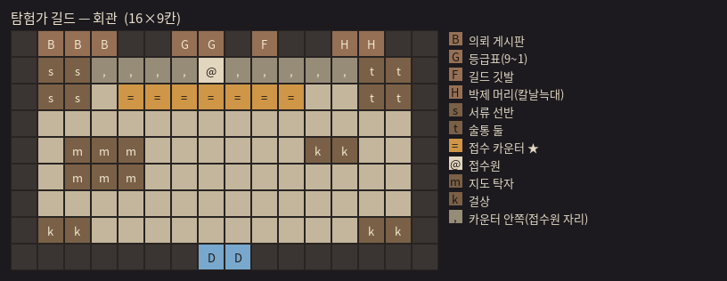
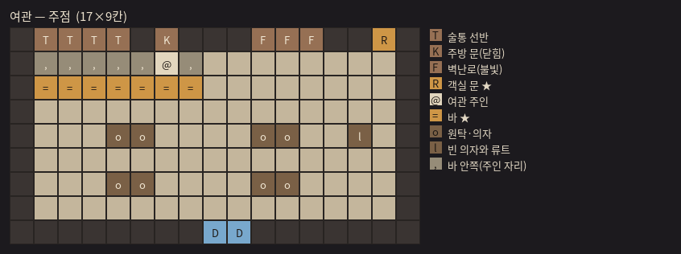
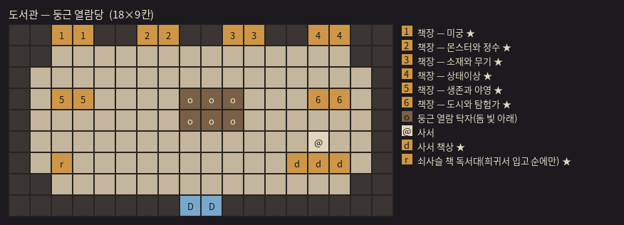
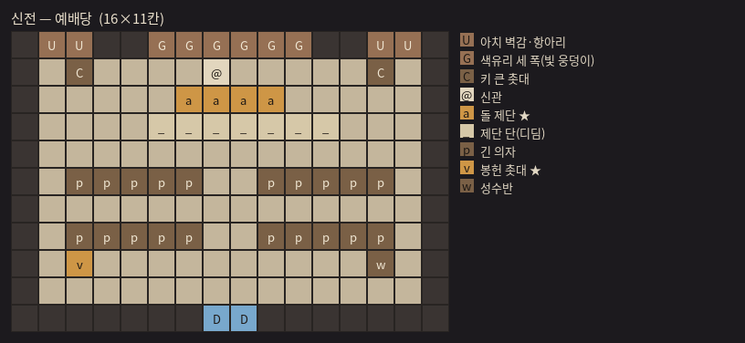
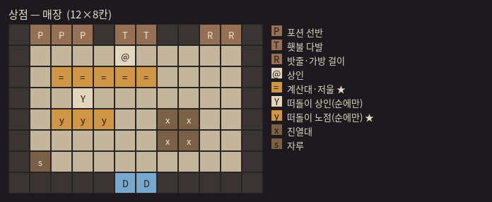
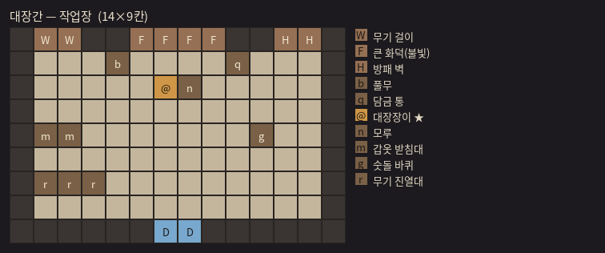
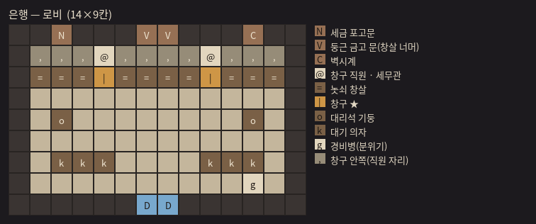

# 도시 건물 실내 v2 — 작은 단층 실내 (기획만, 2026-11-04)

> 2026-11-04 사용자: "도시 내 건물안 만들어줘. 실제 건물이랑 크기 같을 필요는 없는데 필요 이상으로 키울 필요는 없어. 일단 내부만 기획해줘봐"
>
> **상태: 기획만(아직 안 만든다).** 지금 게임은 시설 문에서 Enter = 시설 창(`FacilityView` — CT83). 예전 실내(복층 · 여러 방 — CT62~CT81, 기록 `city_interiors.md`)는 지웠다.
> **배치도**: `docs/plans/interiors/<건물>.png`(모두 한 장 `all.png`) ← 설계 `interiors/boards.json` ← `python3 tools/interior_boards.py`(줄 길이 · 문에서 활동 자리까지 닿음 · 한 화면에 들어감 · 걷는 시간 검사). 결정 ASSUMPTIONS CT106.

---

## 1. 예전 실내에서 겪은 것 → 이번에 지킬 것

| 예전(CT62~CT81) | 사용자 지적 | 이번 |
|---|---|---|
| 건물마다 2~3층 + 지하, 24×23 ~ 28×41칸 | "절반으로"(CT79) · "지하실 제거"(CT80) → 결국 모두 지움(CT83) | **단층 방 하나**, 가장 큰 곳도 18×11칸. **한 화면에 다 보인다**(카메라가 움직이지 않음) |
| 문에서 주 활동까지 5초 기준 | — | **3초 안**(가장 먼 활동 자리 기준 — 배치도 검사 값은 §3 표) |
| 통·궤짝·자루·책 더미 잔뜩, 바닥 무늬 깔개 · 원형 상감 | "잡템 1/3 · 바닥 도형 제거"(CT79) | 잡동사니는 건물마다 0~2개. 바닥 무늬·상감 없음. **그 건물만의 큰 가구 4~6개**로 특색을 낸다 |
| 바닥 재질이 다 같은 마루 · 어두움 | "적당히 밝고 한눈에 특색"(CT67) | 건물마다 바닥 · 벽 재질이 다르고, 광원(난로 · 화덕 · 색유리 · 돔 빛)이 하나씩 |
| 옆벽 문을 정면처럼 그림 · 기둥이 길을 막음 · 벽이 바닥처럼 보임 | CT71 | 문 · 큰 장식은 **북벽(앞면이 보이는 벽)에만**. 옆벽 · 남벽은 윗면 띠만. 기둥은 벽에서 한 칸 띄운다 |
| 입구 벽이 바닥과 이어져 보임 | CT81 | 남벽은 윗면(검은 벽 머리 + 먹선), 문 칸 = 문지방 + 바깥 낮빛 |
| 다가가면 이름판 · 안내 줄 | "창 뜨는 거 없애"(CT77) | 이름판 없음. 활동 자리 · 사람만 검은 테두리 |
| 분위기 사람 + 동작 그림이 어색 | CT76 | **활동을 주는 사람만**(건물마다 1명 — 은행 2명). 서서 숨쉬기 정도. 분위기 사람은 은행 경비병 하나(선택) |
| 가구 뒤지기 · 도시 잡템 | 실내와 함께 지움(CT83) | 이번엔 넣지 않는다(§6-3 — 원하면 다음 단계) |

---

## 2. 공통 규칙

- **들어가기 · 행동력 · 활동 규칙은 지금 그대로**: 시설 문에서 위를 보고 Enter = 들어감(행동력 1 — CT72). 안에서는 활동을 몇 번이든, 도서관 책장은 한 방문에 분야마다 한 번.
- **조작**: W/A/S/D로 걷고, 활동 자리(사람 · 카운터 · 책장 · 제단 …) 앞에서 위를 보고 **Enter = 그 자리의 선택 창**(지금 시설 창의 오른쪽 선택 창과 같은 `ChoicePopup` — 그 자리 활동만 + 값 · 못 하는 이유). 활동 결과는 지금처럼 아래 대화창(이름판 = 그 사람 직함), 창구형(상점 · 대장간 · 은행 · 정수 제거)은 지금 창구 카드 그대로.
- **나가기**: 문 칸으로 걸어 나가면 동네 그 문 앞(아래를 봄). **Esc = 어디서든 바로 나가기**(지금 시설 창의 Esc와 같다 — 매달 아홉 번 드나드는 곳이라). 선택 창 · 창구가 열려 있으면 Esc는 그것만 닫는다.
- **Tab 메뉴 · 도감**: 걷는 중에는 연다(동네와 같다 — 선택 창 · 대화 중에는 안 열림).
- **문구**: 부연설명 · 안내 줄 없음(UI19). 사건 순(오늘의 거리)에만 생기는 것은 **가구나 사람이 서 있는 것**으로 보인다(희귀서 독서대 · 떠돌이 노점 · 축일 촛불) — 글로 알리지 않는다.
- **크기 기준**: 칸 32px × 도시 zoom 1.333 → 화면 약 30×17칸. 방은 **가로 18 · 세로 11칸 이하**(북벽 앞면이 위로 약 2칸 솟고, 아래 대화창 자리를 남긴다). 방이 화면보다 작으니 가운데 두고 둘레는 검게.
- **걷기**: 동네와 같은 빠르기(4.5칸/초) · 몸 크기(`actor_scale` 1.5) · 충돌. 계단 · 사다리 없음.

---

## 3. 건물마다 (배치도 — 맨 윗줄 = 북벽 앞면, ★ = 활동 자리)

| 건물 | 크기(벽 포함) | 문 → 가장 먼 활동 | 바닥 / 벽 | 광원 |
|---|---|---|---|---|
| 탐험가 길드 | 16×9 | 1.1초 | 닳은 참나무 판 / 짙은 돌 | 벽 촛대 · 술통 위 등잔 |
| 여관 | 17×9 | 2.9초(객실 문) | 꿀빛 판 / 반목조 회벽 | **벽난로**(주황 웅덩이) |
| 도서관 | 18×9 | 2.7초 | 따뜻한 사암 판석 / 사암 | **돔 천창**(가운데 탁자 위 흰 빛 기둥) |
| 신전 | 16×11 | 1.6초 | 흰 석회암 판석 / 흰 석회석 | **색유리 세 폭**(붉은 · 금 · 초록 빛 웅덩이) · 촛대 |
| 상점 | 12×8 | 0.9초 | 붉은 흙 타일 / 판자벽 | 매단 등 |
| 대장간 | 14×9 | 1.1초 | 다진 흙 / 그을린 벽돌 | **큰 화덕**(붉은 빛 · 불티) |
| 은행 | 14×9 | 1.6초 | 크림 대리석 / 옅은 잿돌 | 높은 창(서늘한 낮빛) |

외관과 크기를 맞추지 않는다(사용자 "실제 건물이랑 크기 같을 필요는 없는데"). 대신 **건물 성격만큼만** — 상점이 가장 작고, 신전이 가장 깊다(긴 의자 두 줄 + 제단 단).

### 3-1. 탐험가 길드 — 회관



- ★ **접수 카운터**(접수원): 조사 의뢰 보고 · 신원패 반납 · 조사 기록 넘기기 — 지금 길드 활동 셋 모두.
- 특색: 북벽 **의뢰 게시판**(종이 겹침) · **등급표**(9~1 — 그림만, 글 없음) · 길드 깃발 · **칼날늑대 박제 머리** · 서류 선반 · 술통 둘 · 1층 지도가 펼쳐진 **지도 탁자** · 대기 걸상.
- 입구 바로 앞이 카운터(1초) — 가장 자주 오는 곳(귀환 뒤 정산과 이어짐).

### 3-2. 여관 — 주점



- ★ **바**(여관 주인): 요기 · 식사 · ('여관 특식' 순에만) 든든한 식사 · 특식. 식사 그림(요리가 화면을 덮는 것)은 지금 그대로.
- ★ **객실 문**(북벽 오른쪽): 휴식 — 고르면 화면이 어두워졌다 밝아진다(잠 — UI19 연출). 2층 객실은 만들지 않고 **문 하나**로 대신한다.
- 특색: 술통 선반 벽 · 닫힌 주방 문(바 뒤 — 들어가지 않음) · **벽난로** · 원탁 넷 · 구석의 빈 의자와 류트.
- 휴식이 가장 멀다(2.9초) — 한 달에 한두 번이라 괜찮다고 본다.

### 3-3. 도서관 — 둥근 열람당



- ★ **책장 여섯**(분야마다 하나 — 미궁 · 몬스터와 정수 · 소재와 무기 · 상태이상 · 생존과 야영 · 도시와 탐험가): 그 분야 읽기(한 방문에 분야마다 한 번). 넷은 북벽, 둘은 좌우에 홀로 선 책장(앞면이 남쪽).
- ★ **사서 책상**(사서): 고서 해독.
- ★ **쇠사슬 책 독서대**('희귀서 입고' 순에만 선다): 희귀서 열람.
- 특색: 네 모서리를 깎은 **팔각 벽**(밖의 돔 건물과 같은 둥근 느낌 — 칸은 네모로 두고 모서리 칸만 벽), 가운데 **둥근 열람 탁자 + 돔 천창의 빛 기둥**, 높은 책장 이동 사다리(그림만).
- 책장을 열 때 쓰던 책 그림(`paint_books`)은 지금 쓰지 않는다 — 읽기 결과는 지금 문구 그대로.

### 3-4. 신전 — 예배당



- ★ **돌 제단**(신관): 정수 제거(창구) · ('정화 의식' 순) 정화 의식 · ('축일' 순) 축일 미사.
- ★ **봉헌 촛대**(왼쪽 앞): 봉사활동. 촛대 앞에 서서 초를 갈아 꽂는 일 — 사람 없이 자리만.
- 특색: 북벽 **색유리 세 폭**(예전 참고 그림 `city_boards/ref_temple.jpg`에서 — 붉은 · 금 · 초록, 바닥에 그 색 빛 웅덩이) · 양 모서리 **아치 벽감과 항아리** · 키 큰 촛대 둘 · 제단 단(디딤, 지나감) · **긴 의자 두 줄 × 둘** · 성수반.
- '축일' 순에는 긴 의자 끝마다 촛불이 켜져 더 밝다(글 없음).

### 3-5. 상점 — 매장



- ★ **계산대 · 저울**(상인): 구매 · 판매(지금 창구 — 팔기는 `ItemPickWindow`).
- ★ **떠돌이 노점**('떠돌이 상인' 순에만 — 매장 한쪽에 펼친 천 + 떠돌이 상인).
- 특색: 북벽 **포션 선반**(색 병) · 횃불 다발 · 밧줄 · 가방 걸이 · 가운데 진열대 · 문 옆 자루 하나. 바구니는 넣지 않는다(CT79).

### 3-6. 대장간 — 작업장



- ★ **대장장이**(모루 옆): 구매(대장간은 사기만 — 지금 그대로).
- 특색: 북벽 **큰 화덕**(붉은 불빛) · 무기 걸이 · 방패 벽 · 풀무 · **모루** · 담금 통 · 숫돌 바퀴 · 갑옷 받침대 둘 · 무기 진열대.
- 바깥 그림은 모루 · 연기를 되돌렸지만(CT105) **안에는 모루 · 화덕을 둔다** — 바깥과 다른 이야기라 본다(아니면 §6-4).

### 3-7. 은행 — 로비



- ★ **창구 둘**(놋쇠 창살에 뚫린 창 — 창구 직원 · 세무관): 왼쪽 = 돈 맡기기 · 찾기, 오른쪽 = 세금 납부.
- 특색: 창살 너머 북벽 **둥근 금고 문**(들어갈 수 없음) · 세금 포고문 · 벽시계 · 대리석 기둥 둘 · 대기 의자 두 줄 · 문 곁 **경비병**(서 있기만 — 분위기 사람은 여기 하나).
- 잡동사니 없음(CT79 "은행 잡템 전부 제거").

---

## 4. 그림 방식 (만들 때)

- **방 한 장 굽기**: 바닥 · 벽 · 벽 장식은 방마다 큰 그림 하나(동네 바닥 굽기 `town_ground_bake.py`와 같은 손그림 마감 — 집 그림과 같은 먹선 · 붓결). 벽은 칸 줄마다 잘라 발 높이로 세운다(벽 뒤 사람 가림 — 예전 `walls.webp` 방식).
- **가구 = 입체 소품**(동네 소품 `tools/paint_town_props.gd`처럼 윗면 · 옆면 · 접지 그늘 — V27), 한 그림씩 발 높이로 정렬해 사람과 앞뒤가 맞게.
- **사람** = 동네 · 탐험과 같은 몸 그림(`paint_actors` 옷차림) — 접수원 · 여관 주인 · 사서 · 신관 · 상인 · 떠돌이 상인 · 대장장이 · 창구 직원 · 세무관 · 경비병. 예전 옷차림(n8 수도사 · n9 요리사 …)은 지웠으니 새로 그린다.
- **빛**: 방 전체는 동네보다 조금 어둡게, 광원 하나(§3 표)가 둘레를 밝힌다. 색유리 · 돔 · 화덕만 색 빛.
- 그림을 바꾸면 캡처로 직접 본다(`--screen=city --facility=<id>` 같은 캡처 옵션을 새로 둔다).

---

## 5. 데이터 · 코드 꼴 (초안)

```jsonc
// data/interiors/<시설 id>.json — 배치도 boards.json의 한 방과 같은 꼴
{
  "id": "inn", "facility": "inn",
  "rows": ["#TTTT#K###FFF##R#", "#,,,,,@,........#", "…"],
  "legend": {"T": {"name_ko": "술통 선반", "kind": "wall", "art": "inn_barrel_shelf"}, "…": {}},
  "spots": [
    {"at": "=", "npc": "innkeeper", "activities": ["inn_snack", "inn_meal", "inn_hearty", "inn_feast"]},
    {"at": "R", "activities": ["inn_rest"]}
  ],
  "event_props": [{"event": "inn_special", "char": "…"}],   // 사건 순에만 서는 가구(희귀서 독서대 · 떠돌이 노점 · 축일 촛불)
  "floor": "honey", "wall": "plaster", "light": [{"char": "F", "color": "#e08a3c", "radius": 5}]
}
```

- 사건 활동(`extra`)은 지금처럼 그 순에만 선택지에 붙는다 — 그 활동을 주는 자리에 붙인다(`spots.activities`에 넣어 두고 그 순이 아니면 빠짐).
- 화면 `InteriorView`(새로 — 동네 걷기 `TownView`의 걷기 · 충돌 · 사람 그림을 나눠 쓴다), 선택 창 · 대화 · 창구는 `FacilityView`에서 떼어 같이 쓴다. 300줄 안으로 나눈다.
- 검사: `validate_data.gd` — 시설 활동마다 어느 자리에 있는가 · 문에서 모든 자리에 닿는가 · 크기 상한(`city.json interior.max_size` [18, 11]).
- `FacilityView`(시설 창)는 실내가 없는 시설(거래소 등 특별 시설 — CT63)에 남긴다.

---

## 6. 정할 것 (사용자 — 추천은 굵게)

1. **배치 · 크기**: 위 배치도대로 갈지. 더 줄이려면 길드 · 여관 · 도서관 → 14×8 언저리까지는 된다(특색 가구가 한두 개 빠짐).
2. **Esc로 바로 나가기**: **둔다**(추천 — 자주 드나듦) / 문까지 걸어야만 나간다(몰입).
3. **가구 뒤지기 · 도시 잡템**: **이번엔 넣지 않는다**(추천 — 다시 커지기 쉬움) / 건물마다 한 곳만(한 순에 한 번 — CT74 방식).
4. **대장간 안 모루 · 화덕**: **둔다**(추천) / 바깥처럼 뺀다(CT105와 맞춤).
5. **분위기 사람**: **은행 경비병 하나만**(추천) / 없음 / 길드 탐험가 · 여관 손님 · 신전 신도까지 하나씩.
6. **여관 휴식**: **객실 문 하나**(추천) / 2층 객실 방 하나(작게 — 걷는 시간 +3초쯤).

## 7. 만드는 순서 (결정 뒤)

| 단계 | 할 일 | 크기 |
|---|---|---|
| I0 | 실내 화면(걷기 · 충돌 · 자리 Enter → 선택 창 · 문 · Esc) + 데이터 꼴 + 검사기 — 그림은 색 칸으로 | 중간 |
| I1 | **신전 하나로 시범**(색유리 · 빛 웅덩이 · 긴 의자 · 신관) — 크기 · 밝기 · 걷는 느낌을 직접 보고 조절 | 중간 |
| I2 | 나머지 여섯 + 사람 옷차림 | 큼(그림이 대부분) |
| I3 | 사건 순 가구 · 소리 키(문 · 화덕 · 종) | 작음 |
